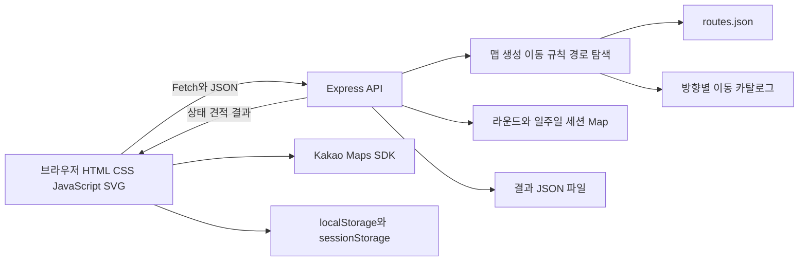

# ROUTE 기술 및 데이터 구조

ROUTE는 정적 웹 화면과 Express API를 한 Node.js 서버에서 제공한다. 게임 규칙을 JSON으로 정의하고 서버가 맵 생성, 이동 판정, 기준 경로 탐색을 담당한다. 실제 지도 모드에서는 카카오맵 SDK로 지도를 표시하고, 저장된 공개 교통 자료로 이동을 계산한다.

## 기술스택과 파일 구성

| 영역 | 기술 | 주요 파일과 역할 |
| --- | --- | --- |
| 화면 구조 | HTML | [`public/index.html`](../public/index.html): 홈, 레벨 선택, 지도, 결과, 설정 |
| 스타일 | CSS | [`public/style.css`](../public/style.css), [`public/ui.css`](../public/ui.css): 지도·반응형 화면·모달·수단 카드 |
| 화면 동작 | Vanilla JavaScript, DOM, SVG, Kakao Maps SDK | [`public/game.js`](../public/game.js): API 요청, 지도, 이동, 재생. [`public/ui.js`](../public/ui.js): 탐색, 포커스, 화면 안내. [`public/kakaoMap.js`](../public/kakaoMap.js)는 실제 지도 오버레이와 경유지를 표시한다. |
| 서버 | Node.js 18 이상, Express 5 | [`server.js`](../server.js): 정적 파일 제공, JSON API, 세션, 비용·결과 판정 |
| 게임 엔진 | JavaScript, 최소 힙, Float32Array | [`lib/engine.js`](../lib/engine.js): 그래프 생성, 자원 규칙, 상태 확장 탐색, 목표 평가 |
| 규칙 데이터 | JSON | [`routes.json`](../routes.json): 수단, 역 이름, 환승, 컨디션, 레벨, 캠페인, 일주일 정의 |
| 테스트 | LinkeDOM, Node.js assert·vm | [`tests/ui-usability.cjs`](../tests/ui-usability.cjs): DOM과 실제 Express 핸들러의 연동 검사 |
| 의존성 관리 | npm, package-lock.json | 런타임 직접 의존성은 Express, 개발 직접 의존성은 LinkeDOM이다. |

프런트엔드 프레임워크·번들러·ORM은 사용하지 않는다. 실행은 `npm ci`와 `npm start`, 검증은 `npm test`다. 기본 포트는 3000이며 `PORT` 환경 변수로 변경한다.

## 시스템과 요청 흐름

1. 브라우저가 게임 시작을 요청하면 서버가 설정을 선택하고 기본 모드에서는 `newRound()`, 실제 지도 모드에서는 `newSegmentRound()`로 지도를 생성한다.
2. 엔진이 조건을 만족하는 기준 경로를 계산하고, 서버가 초기 조건과 진행 상태를 세션에 보존한다.
3. `publicState()`가 지도·자원·현재 위치와 수단별로 유효한 인접 이동의 견적을 반환한다. 견적 키는 `역ID:수단`이고 값에는 시간·요금·환승 여부·체력 비용이 들어간다.
4. 사용자가 수단 카드를 누르면 브라우저는 세션 ID, 목적 역 ID, 수단을 전송한다. 이동 비용이나 성공 여부를 직접 결정해 보내지 않는다.
5. 서버가 세션·인접성·수단·돈·체력을 검증하고 이동을 적용한다. 시간 초과, 도착, 더 이동할 수 없는 상태 순으로 결과를 판정한다.
6. 응답의 상태와 결과로 화면을 갱신한다. 종료 결과에는 기준 경로와 분기점 힌트가 포함된다.

일반 화면에서는 제한 시간을 넘기는 수단을 비활성화한다. 서버는 해당 이동이 요청되면 시간 초과 실패로 판정한다. 화면의 조작 제한과 서버의 최종 판정을 구분한다.

## 라운드 그래프 생성

- **기본 모드**는 `buildLegacyGraph()`로 역 이름이 있는 격자와 수단별 게임 시간을 만든다. `roundParams()`가 라운드에 따른 크기·자금·난이도 설정을 반환한다.
- **실제 지도 모드**는 `node tools/buildCommuteCatalog.cjs`로 공개 철도·버스·보행 원본을 `data/commuteSegments.json`에 합친다. 간선 후보는 양방향 도보 시간이 확보된 철도 연결과 석계역–광운대역 연결을 우선하고, 역별로 짧은 도보 연결 두 개와 가장 빠른 버스 연결도 남긴다. 각 간선의 수단별 시간은 방향별로 저장한다. 런타임에는 `newSegmentRound()`가 광운대역 쪽에서 연결된 역 일부를 선택하고 정해진 노선 조건과 게임 규칙에 맞춰 완주 가능한 라운드를 찾는다.
- 서버는 역 좌표, 연결선, 현재 위치, 경유지와 견적을 브라우저에 전달한다. `realMapEnabled`인 세션에서 실제 지도 전환이 열리며 카카오맵의 마커와 선도 같은 역 ID를 사용한다. 프런트엔드는 현재 시간·비용·체력으로 이용 가능한 견적이 있는 역만 선택 대상으로 표시한다.

## 이동 판정과 기준 경로 알고리즘

`solveOptimal()`은 최소 힙에서 **누적 이동 시간이 가장 작은 상태**를 먼저 꺼내는 다익스트라 기반 탐색이다. 같은 역이라도 남은 자원이나 환승 조건이 다르면 다음 선택이 달라지므로 각각을 별도의 상태로 다룬다. 도착 시간이 같은 후보는 비용이 적은 경로를 우선한다.

| 상태 | 의미 |
| --- | --- |
| 현재 역, 누적 시간 | 다음 이동 후보와 사건 적용 시점을 결정한다. |
| 누적 교통비와 사용 체력 | 예산과 체력 한도를 넘는 탐색 후보를 제외한다. |
| 환승 잔여 시간 | 다음 탑승 시 환승 규칙을 적용할지 결정한다. |
| 현재 호선, 기납부 요금, 적용된 별도운임 | 실제 데이터 탐색에서 같은 호선 연속 탑승, 환승 차액과 신분당선 별도운임을 계산한다. |
| 경유 여부 | 심부름 경유 조건을 포함한 기준 경로에서 방문을 추적한다. |

기본 격자 탐색은 교통비를 50원 단위로, 체력은 보수적으로 5단위로 묶어 재사용하는 `Float32Array` 버퍼에 기록한다. 실제 데이터 탐색의 `solveVerified()`는 `Map`에 상태를 저장하고 정수 체력을 그대로 사용한다. 사건이 있을 때는 발동 전 도착 시각도 상태 구분에 포함한다.

실제 지도 모드에서 서버의 견적·이동·기준 경로는 `movesFrom()`과 `movement()`로 수단별 규칙을 계산한다. 같은 호선의 연속 탑승은 환승 가산 없이 처리하고, 환승 시에는 기존에 낸 기본요금과 새 수단 기본요금 간 차액에 해당 구간의 별도운임을 반영한다. 사건의 시간 배율이나 수단 중단은 **이동을 시작할 때의 누적 시간**을 기준으로 적용한다.

라운드를 시작할 때 사건 없는 기준 시간으로 사건 발생 분을 정하고, 사건이 있으면 그 조건에서 기준 경로를 다시 계산한다. 심부름은 따로 경유 경로를 검증하며 플레이어에게는 선택 목표로 제공한다. 제한 시간은 `올림(기준 경로 시간 × 레벨별 여유 배율)`이다.

## 데이터 저장 위치와 수명

| 데이터 | 위치·형식 | 저장 내용 | 유지 범위 |
| --- | --- | --- | --- |
| 게임 규칙 | `routes.json` | `modes`, `stations`, `transfer`, `personas`, `levels`, `scenarios`, `week` | 소스 파일로 관리 |
| 화면 설정 | localStorage의 `route.settings` | 다크 모드, 애니메이션 줄이기, 튜토리얼 설정 | 같은 브라우저·출처에 유지 |
| 레벨 기록 | localStorage의 `route.progress` | 레벨 ID별 최고 별점. 다음 레벨 해금에 사용 | 같은 브라우저·출처에 유지 |
| 기기 플레이 횟수 | localStorage의 `route.plays` | 해당 브라우저의 플레이 횟수 | 저장소 삭제 전까지 유지 |
| 접속 플레이 횟수 | sessionStorage의 `plays` | 현재 탭 접속의 플레이 횟수 | 탭 세션 기준 |
| 화면 진행 상태 | 브라우저 JavaScript 메모리 | 현재 세션 응답, 선택, 모드, 재생 상태 | 새로고침 시 초기화 |
| 라운드 세션 | 서버의 `sessions` Map | 초기 조건, 지도, 기준 경로, 현재 위치, 사용 자원, 이동 기록, 결과 | 서버 재시작 시 소멸. 마지막 갱신 후 1시간을 넘으면 정리 대상 |
| 일주일 세션 | 서버의 `weeks` Map | 현재 요일, 저금, 지각, 친구 도움, 우산, 일별 결과, 확정 전 결과 | 서버 재시작 시 소멸. 마지막 갱신 후 6시간을 넘으면 정리 대상 |
| 서버 결과 기록 | `data/game_history.json` | 종료 시각, 모드, 레벨, 성공 여부, 등급, 효율, 시간, 사용 교통비 | 파일에 최근 최대 500건 보관 |

메모리 세션 정리는 10분 간격으로 수행하므로 시간 한도에 도달하는 즉시 삭제되는 구조는 아니다. 서버 결과 파일이 없거나 읽을 수 없으면 빈 기록으로 시작한다. 이 파일은 완료 결과 기록이며 진행 중 세션을 복원하지 않는다. `/api/history` 통계는 보관된 기록 기준이므로 전체 서비스 수명의 누적 통계와 다르다.

회원 계정·사용자별 DB·기기 간 동기화는 없다. localStorage의 레벨 기록은 사용자가 수정할 수 있으므로 서버 인증이나 경쟁 순위의 신뢰 근거로 쓰지 않는다.

### 서버 종료 기록의 형식

`finish()`가 성공·실패·포기를 확정하면 `appendHistory()`가 기존 배열을 읽고 결과 요약 한 건을 추가한 뒤 최근 500건을 파일에 다시 쓴다. `at`은 UTC ISO 시각이다.

| 필드 | 의미 |
| --- | --- |
| `at`, `mode`, `round`, `scenario`, `level` | 종료 시각과 게임 문맥. 해당 시나리오나 레벨이 없으면 `null` |
| `status`, `grade`, `stars`, `efficiency` | 성공 또는 실패, 등급, 별점, 효율 백분율. 포기는 실패로 기록되며 레벨 외 별점은 `null` |
| `time`, `res` | 실제 사용 시간(분)과 교통비(원) |

역별 이동 이력 `path`, 기준 경로 `optimal`, 힌트는 세션 상태와 종료 응답에서 제공한다. 서버 파일의 한 건은 라운드 요약이다. 서버 표준 출력에는 실행 주소와 오류를 남기며, 파일 쓰기 실패는 경고로 기록한다. 브라우저의 시작 횟수는 라운드 시작·재도전이 열렸을 때 증가하므로 서버의 종료 건수와 다를 수 있다.

## 세션과 일주일 진행

라운드 세션은 `init`에 지도, 출발·목적지, 제한 시간, 초기 자원, 기준 경로, 사건·경유 조건을 보존한다. 같은 지도 재도전은 종료된 세션의 `init`으로 새 세션을 만들고 위치·사용 자원·환승·이동 기록·심부름 상태를 초기화한다.

일주일 모드는 하루가 끝났을 때 결과를 `pending`에 두고, 다음 날 API 요청에서 저금·지각·친구 도움을 확정한다. 그 전에는 같은 지도 재도전이 가능하다. 월~목 성공 시 남은 교통비 절반을 50원 단위로 내림해 최대 1,500원까지 저금한다. 수요일에는 저금으로 우산을 살 수 있고, 금요일에는 남은 저금을 교통비에 보탠다. 화요일 친구 도움은 목요일 사건 정보에 연결되고 전날 지각은 다음 날 체력에 영향을 준다.

## 주요 API

| 메서드·경로 | 주요 입력 | 역할 |
| --- | --- | --- |
| `GET /api/routes` | 없음 | 수단·컨디션·레벨·캠페인 목록 |
| `GET /api/history` | 없음 | 보관 기록의 플레이·성공 횟수와 최고 성공 라운드 |
| `POST /api/simulate/start` | `mode`, 모드별 `levelId`·`scenarioId`·`weekId`·`round`·`choice` | 지도 생성과 세션 시작 |
| `POST /api/simulate/step` | `sessionId`, 정수 `to`, `mode` | 이동 검증, 자원 차감, 종료 판정 |
| `POST /api/simulate/retry` | `sessionId` | 종료된 라운드의 같은 지도 재도전 |
| `POST /api/simulate/giveup` | `sessionId` | 진행 중 라운드를 실패로 종료 |
| `POST /api/week/start` | 빈 객체 | 일주일 세션 생성과 첫날 안내 |
| `POST /api/week/next` | `weekId` | 종료한 하루의 결과 확정과 다음 날 안내 |

`/api/simulate/start`의 `mode`는 `endless`, `campaign`, `level`, `week` 중 하나다. 이동 API의 `mode`는 `subway`, `bus`, `walk` 중 하나로, 같은 필드 이름이 요청 종류에 따라 다른 의미를 갖는다. JSON 요청 크기는 10KB로 제한하며 브라우저 요청 제한 시간은 시작 요청 35초, 그 외 15초다. 시작은 상태를 바로 돌려주고, 이동과 포기는 `{ state, result }`를 돌려준다. 진행 중 이동의 `result`는 `null`이다.

## 별점과 효율

레벨 모드의 별점은 도착 성공 1점, 목표 시간 이내 또는 심부름 완료 1점, 자금 또는 체력 절약 1점으로 구성한다. `levelGoals()`가 기준 경로에서 목표를 도출하고 `evalGoals()`가 종료 상태를 평가한다. 기준 경로는 세 목표를 함께 달성할 수 있도록 목표를 정한다.

성공 효율은 `min(1, 기준 시간 / 실제 사용 시간)`이며 등급 기준은 A+ 95%, A 85%, B 70%, C 50%, 그 미만 D다. 실패는 효율 0%, 등급 `-`로 표시한다. 별점과 효율 등급은 서로 다른 평가다.

## 검증과 운영 범위

`npm test`는 별도 임시 디렉터리의 서버와 테스트 DOM을 연결한다. 실제 Express 핸들러를 호출하지만 네트워크 포트를 열지 않고, 개발 서버의 플레이 기록에도 쓰지 않는다. 초기화, 화면 전환, 오조작 방지, 자원 부족 안내, 이동, 재도전, API 실패 복구, 일주일 진행, 심부름 결과, 사건 안내 등을 검증하며 별도의 Node 테스트도 실행한다. `npm run data:check`는 선택한 카탈로그에서 레벨 1~15의 완주 가능한 라운드를 생성할 수 있는지 검사한다.

실제 브라우저의 팝오버 위치·겹침·터치 조작·색 대비, 동시 사용자 처리량, 장시간 운영 성능은 이 테스트로 검증하지 않는다. 인증·다중 서버 세션 공유·DB 트랜잭션은 구현되어 있지 않다. 결과 JSON 파일의 동기식 입출력과 메모리 세션은 단일 서버 중심의 현재 구조이므로 운영 규모를 늘릴 때 재검토해야 한다.

공유 소스에는 실행 코드, 규칙, 잠금 파일, 테스트, 공개 문서를 포함한다. 의존성 폴더, 실제 플레이 기록, 비밀키·환경 파일, 로컬 설정, 내부 인수인계·작업 메모, 배포용 압축 파일은 업로드 대상에서 제외한다.
